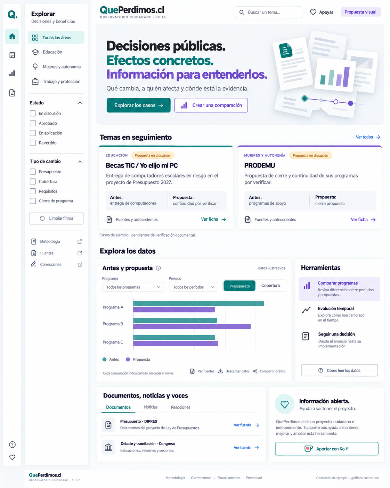

# Diseño claro v3 — interfaz anterior de Que Perdimos



**Identidad aplicada:** [Q/lupa con segmento separado](identidad-visual.md). La marca del mockup y su distintivo “Propuesta visual” son históricos; usar los recursos vectoriales aprobados.

**Versión:** 3.0  
**Fecha:** 7 de octubre de 2026  
**Estado:** especificación de la interfaz anterior de Que Perdimos. La dirección queda obsoleta para Resonaria y debe servir solo como referencia de accesibilidad y componentes reutilizables.
**Documentos relacionados:** QuePerdimos-plan-de-proyecto.md y QuePerdimos-diseno-editorial-v2.md.

Esta versión reemplaza la dirección visual propuesta en la versión 2: fuentes sans-serif, superficies claras y dos colores de acento. Conserva los requisitos editoriales del plan del proyecto. La imagen es un mockup; sus gráficos y controles son ilustrativos. La aprobación del diseño no convierte los casos de ejemplo en información verificada ni activa medios de cobro.

**Uso de este documento:** guía para un desarrollador o agente encargado de implementar el portal. Las dimensiones son valores iniciales para validar en navegador. Los textos, imágenes y datos de ejemplo no deben publicarse como evidencia real.

## 1. Identidad y objetivo

Crear un portal luminoso, ordenado y fácil de explorar. La identidad se apoya en verde petróleo y violeta, con texto oscuro sobre blanco y gris muy claro.

La composición combina la claridad de una portada informativa con navegación de aplicación: una barra de iconos y un panel contextual independiente.

Mensaje de portada propuesto:

> Decisiones públicas.  
> Efectos concretos.  
> Información para entenderlos.

Texto de apoyo:

> Qué cambia, a quién afecta y dónde está la evidencia.

La primera línea usa texto oscuro, la segunda verde petróleo y la tercera violeta. Todo el texto usa sans-serif.

## 2. Referencia del menú

Se observó el sitio público https://singles.tcghub.cl/ durante esta revisión. Su estructura visible combina:

- Barra vertical estrecha con iconos.
- Panel claro separado para categorías y filtros.
- Contenido principal a la derecha.
- Superficies blancas, bordes suaves y espacios entre paneles.

Para QuePerdimos se adapta esa estructura a áreas temáticas, estados y tipos de cambio. No se incorporan funciones de compra, carrito o cuenta de tienda.

No se inspeccionaron los archivos del proyecto TCGHub del computador del usuario: esos archivos no estaban disponibles en el entorno de trabajo. La referencia aplicada es la interfaz pública observada, no una copia de sus componentes de código.

## 3. Paleta propuesta

| Función | Color | Aplicación |
| --- | --- | --- |
| Fondo | `#F5F7F9` | Lienzo general |
| Superficie | `#FFFFFF` | Paneles, navegación y fichas |
| Texto | `#202632` | Títulos y contenido |
| Texto secundario | `#5B6575` | Ayudas y metadatos |
| Borde | `#E1E6EC` | Separadores decorativos |
| Acento principal | `#0F766E` | Acciones principales y selección |
| Principal hover | `#0B5F59` | Estado interactivo |
| Principal suave | `#E0F3F1` | Icono activo y área seleccionada |
| Acento secundario | `#7355C8` | Herramientas, títulos y segunda serie |
| Secundario hover | `#5E43AE` | Estado interactivo |
| Secundario suave | `#EEE9FB` | Herramienta seleccionada |
| Pendiente, texto | `#78520B` | Estado de discusión |
| Pendiente, fondo | `#FFF0D1` | Etiqueta semántica |

Los dos acentos principales deben repetirse de forma consistente. El ámbar se reserva para estado pendiente; no es un tercer color de marca.

En la implementación, los enlaces también usarán verde petróleo o violeta. Algunos tonos de la imagen generada pueden desviarse de estos valores: los tokens del documento son la referencia técnica.

Colores de series gráficas no representan aprobación, perjuicio o mejora. La leyenda debe explicar cada serie.

## 4. Tipografía y formas

**Familia propuesta:** Inter, con alternativas Manrope o una sans-serif del sistema si se decide evitar archivos externos. Validar licencia y disponibilidad de la familia elegida.

- Títulos: peso 650–750.
- Texto: peso 400–450.
- Controles y subtítulos: peso 500–600.
- Cuerpo: 16–18 px, interlineado 1,5–1,65.
- Metadatos: al menos 13–14 px.
- Título principal: 40–52 px en escritorio, 30–38 px en móvil.
- Títulos de sección: 24–30 px.

Evitar serif en marca, títulos, fichas, tablas y gráficos. No condensar textos ni usar mayúsculas extensas.

Paneles con radios de 10–14 px, sombras suaves solo donde ayuden a separar navegación y contenido. Iconos lineales de una misma familia, con grosores consistentes.

## 5. Navegación lateral en dos piezas

### 5.1 Barra de iconos

Ancho propuesto: 60–68 px. Margen exterior: 10–12 px. Superficie blanca y borde suave.

Entradas:

1. Marca abreviada Q.
2. Panorama.
3. Casos.
4. Comparador.
5. Documentos.
6. Ayuda.
7. Apoyar.

Cada icono requiere nombre accesible y tooltip para usuarios de mouse, además de selección perceptible por forma y color. No depender del tooltip para uso táctil.

### 5.2 Panel contextual

Ancho propuesto: 210–240 px. Título “Explorar” y subtítulo “Decisiones y beneficios”.

Áreas iniciales de ejemplo:

- Todas las áreas.
- Educación.
- Mujeres y autonomía.
- Trabajo y protección.

Filtros:

- Estado: En discusión, Aprobado, En aplicación, Revertido.
- Tipo: Presupuesto, Cobertura, Requisitos, Cierre de programa.

Los tipos y estados simplificados deben corresponder al modelo editorial preciso. Por ejemplo, una propuesta de cierre puede incluir una modificación presupuestaria: no forzar categorías mutuamente excluyentes si el caso tiene varias dimensiones.

Al final: Limpiar filtros, Metodología, Fuentes y Correcciones.

Los filtros afectan el catálogo de casos indicado, no todos los contenidos indiscriminadamente. Mostrar filtros activos y contexto para que el lector comprenda qué cambió.

### 5.3 Comportamiento

- Permitir ocultar el panel contextual sin perder la barra de iconos.
- Mantener accesibles los enlaces inferiores en pantallas de poca altura.
- Si el panel tiene scroll propio, conservar foco y navegación por teclado.
- Evitar que la barra y el panel resten ancho excesivo al contenido.
- Guardar filtros en la URL cuando se trate de una selección compartible.
- No mostrar funciones futuras como si ya estuvieran operativas.

## 6. Portada

### Encabezado

Marca, subtítulo del observatorio, búsqueda y enlace pequeño de apoyo. El distintivo “Propuesta visual” pertenece al mockup; no se publica en producción.

### Presentación

Mensaje de tres líneas y dos acciones: Explorar los casos y Crear una comparación. La segunda solo aparece como acción operativa cuando el comparador esté disponible.

La ilustración de documentos es opcional y decorativa. No contiene cifras reales ni sustituye una comparación. Puede omitirse en móvil.

### Temas en seguimiento

Dos columnas en escritorio y una en móvil. Cada ficha breve muestra:

- Área y estado.
- Nombre del programa.
- Explicación del cambio.
- Antes / Propuesta o Antes / Después.
- Fuentes y acceso al expediente.

Becas TIC y PRODEMU son ejemplos tomados del plan; el mockup no acredita sus estados actuales. Antes de publicar, revisar documentos y actualizar redacción.

Las líneas verde y violeta distinguen visualmente las tarjetas, sin crear una clasificación temática permanente que el lector pueda interpretar erróneamente.

### Superficie vigente

La portada y la ficha no usan gráficos ni tarjetas con borde de color. La portada es un índice de lectura. En la ficha, la mitad de redes incrusta el reproductor oficial de TikTok, Instagram y X, y se recorre deslizando. Las reglas de gráficos de más abajo quedan para un comparador con datos reales.

### Explora los datos

Comparador amplio junto a herramientas:

- Comparar programas.
- Evolución temporal.
- Seguir una decisión.

La comparación muestra programa, período y métrica. Añadir unidades, valores, fuente y límites en la implementación. Los gráficos del mockup están marcados como ilustrativos.

### Documentos, noticias y voces

Pestañas para documentos, noticias y reacciones. Conservar autoría, emisor, fecha, enlace y relación con el caso. Enlazar documentos concretos, no solamente portales generales.

### Apoyo

Módulo pequeño al final: Información abierta, Ayuda a sostener el proyecto y Aportar con Ko-fi. La plataforma final se elige tras validar cobro y retiro; el diseño no implica una cuenta activa.

## 7. Reglas para gráficos

- Verde petróleo para Antes y violeta para Propuesta o Después.
- Leyenda estable, etiquetas claras y alternativas accesibles.
- Barras con base cero para comparar magnitudes.
- Usar una línea cuando se estudie evolución temporal.
- No mezclar dinero y personas en un eje.
- Dato ausente no equivale a cero.
- Distinguir moneda corriente y real.
- Identificar presupuesto aprobado, vigente, ejecutado o propuesto.
- Revisar cambios de clasificación antes de comparar.
- Incluir tabla equivalente y descargar datos con sus fuentes.
- Compartir la selección y los límites junto al gráfico.

Las herramientas se activan solo con datos suficientes y comparables. Mostrar información pendiente cuando corresponda.

## 8. Adaptación responsive

| Pantalla | Menú | Contenido |
| --- | --- | --- |
| Escritorio amplio | Barra y panel visibles | Dos columnas de casos y comparador con herramientas |
| Tablet | Barra visible; panel ocultable | Columnas según ancho útil |
| Móvil | Encabezado y menú desplegable | Una columna; filtros en panel temporal |

En móvil, el panel de filtros requiere acción Aplicar y Limpiar, foco controlado y cierre explícito. Mantener borrador de filtros hasta aplicar si ese patrón mejora comprensión.

No reducir la letra para conservar el diseño de escritorio. Apilar controles y ofrecer tabla alternativa cuando el gráfico no sea legible.

## 9. Publicidad y privacidad

Conservar la política del proyecto: máximo inicial de un espacio publicitario por página y sin popup, anuncio superpuesto ni video automático.

Si se incluye patrocinio, ubicarlo después de los casos o de la explicación central, con rótulo explícito y diseño diferenciado de las fuentes. El módulo de apoyo no es un anuncio.

El sitio debe leerse sin anuncios, widgets externos o inserciones sociales. No perfilar a lectores según ideología ni entregar listas de aportantes a anunciantes.

## 10. Tokens iniciales

```css
:root {
  --canvas: #f5f7f9;
  --surface: #ffffff;
  --text: #202632;
  --muted: #5b6575;
  --border: #e1e6ec;
  --primary: #0f766e;
  --primary-hover: #0b5f59;
  --primary-soft: #e0f3f1;
  --secondary: #7355c8;
  --secondary-hover: #5e43ae;
  --secondary-soft: #eee9fb;
  --pending-text: #78520b;
  --pending-bg: #fff0d1;
  --rail-width: 64px;
  --context-width: 224px;
  --panel-radius: 12px;
  --space-unit: 4px;
}
```

Los bordes suaves son decorativos; controles y foco deben tener contraste suficiente. Verificar contraste de texto, estados y tamaños reales al implementar.

## 11. Componentes propuestos

AppShell, IconRail, ContextFilters, MobileMenu, SearchField, PortalLead, CaseCard, StatusBadge, QuickComparison, ComparisonControls, ChartPanel, ChartDataTable, ToolNavigation, SourceTabs, DocumentRow, PublicReaction, SupportPanel y SponsorSlot.

Las fichas completas conservan la estructura del plan: resumen, comparación, efectos, población, responsables, justificación, cronología, fuentes y correcciones.

## 12. Validación

- [ ] Todo el sistema tipográfico usa sans-serif.
- [ ] Predominan las superficies claras.
- [ ] Verde petróleo y violeta tienen funciones consistentes.
- [ ] La barra y los filtros se entienden también en móvil.
- [ ] Los iconos cuentan con nombres accesibles.
- [ ] La lectura distingue propuesta, aprobación y aplicación.
- [ ] La fecha de revisión es visible en fichas reales.
- [ ] Los gráficos incluyen unidades, períodos y fuentes.
- [ ] Las comparaciones no inventan números ni completan vacíos con ceros.
- [ ] Apoyo y publicidad no interrumpen la lectura.
- [ ] Las funciones no implementadas no aparecen operativas.
- [ ] Se prueba teclado, contraste, texto ampliado y ancho de 360 px.

## 13. Mapa de pantallas y acciones

| Elemento | Destino o acción | Resultado esperado |
| --- | --- | --- |
| Marca Q. y logo completo | `/` | Volver al panorama |
| Icono de panorama | `/` | Mostrar la portada y su selección activa |
| Icono de casos | `/casos` | Abrir catálogo y filtros |
| Icono de comparador | `/comparador` | Abrir herramienta si está habilitada |
| Icono de documentos | `/documentos` | Abrir catálogo de fuentes si existe; en MVP puede conducir a fuentes dentro de casos |
| Buscar un tema | Búsqueda del catálogo | Encontrar programa, alias, título o área |
| Explorar los casos | `/casos` | Ver catálogo sin filtros implícitos |
| Crear una comparación | `/comparador` | Elegir programa, período y métrica |
| Ver todos | `/casos` con selección vigente si corresponde | Continuar exploración con contexto explícito |
| Ver ficha | `/casos/{slug}` | Abrir expediente completo |
| Fuentes y antecedentes de una tarjeta | `/casos/{slug}#fuentes` | Ir directamente a evidencia del caso |
| Ver fuentes de un gráfico | Panel de metodología y fuentes de esa selección | Consultar documentos, unidades y fórmula |
| Descargar datos | Exportación del conjunto seleccionado | Obtener datos y referencias |
| Compartir gráfico | Copiar URL con configuración | Reproducir selección, sin incluir datos personales |
| Aportar con Ko-fi | Checkout autorizado y configurado | Aporte voluntario con condiciones visibles |
| Correcciones | `/correcciones` | Ver historial y enviar una observación |

Las rutas son propuestas de implementación. Si una función no existe, ocultar su acción o explicar su estado de manera explícita; evitar enlaces que no hacen nada.

## 14. Contrato funcional de los filtros

### Relación entre portada y catálogo

En la portada, los filtros laterales afectan únicamente “Temas en seguimiento”, con un texto que lo indique. Presentación, documentos destacados y herramienta de ejemplo no deben cambiar silenciosamente.

En el catálogo, esos mismos filtros operan sobre todos los casos públicos. El catálogo conserva la selección al abrir una ficha y volver.

La búsqueda consulta nombre oficial, aliases, título y resumen. Normalizar tildes y mayúsculas cuando el motor lo permita. No buscar automáticamente en publicaciones privadas ni fuentes sin acceso autorizado.

### Combinación propuesta

- Varias áreas seleccionadas: OR dentro del grupo.
- Varios estados seleccionados: OR dentro del grupo.
- Varios tipos de cambio: OR dentro del grupo.
- Entre grupos: AND.
- Sin selección en un grupo: no restringe por ese criterio.
- “Todas las áreas” limpia solo el grupo de áreas.
- “Limpiar filtros” limpia todos los grupos y la búsqueda; anunciar el resultado.

Ejemplo: Educación + Mujeres, En discusión y Presupuesto devuelve casos de cualquiera de esas áreas que estén en discusión y tengan cambio presupuestario.

Usar parámetros legibles, por ejemplo:

```text
/casos?area=educacion&estado=en-discusion&tipo=presupuesto&q=becas
```

Validar parámetros y descartar valores desconocidos con comportamiento predecible. El servidor aplica los mismos criterios que la interfaz.

### Interacción y carga

En escritorio, las selecciones pueden aplicarse de inmediato. La búsqueda escrita usa un pequeño debounce y permite confirmar con Enter. Cancelar solicitudes anteriores para que respuestas tardías no sobrescriban una selección más reciente.

En móvil, abrir panel temporal con selección en borrador y botones Aplicar y Limpiar. Cancelar conserva la selección aplicada anterior; Aplicar actualiza URL y resultados, cierra el panel y devuelve el foco.

Mostrar filtros activos, resultado vacío y opción de limpiar. No sustituir resultados vacíos por casos populares sin indicar el cambio.

## 15. Contrato de datos y presentación

### Caso

Campos mínimos para renderizar una tarjeta:

- ID y slug estable.
- Título y nombre oficial del programa, cuando corresponda.
- Área o áreas.
- Resumen breve.
- Estado procedimental preciso y etiqueta pública simplificada.
- Tipos de cambio.
- Texto de la situación anterior y texto de propuesta o situación posterior.
- Fecha de última revisión y próxima revisión.
- Disponibilidad de evidencia, límites y fuentes asociadas.

La etiqueta “En discusión” se deriva de un estado explícito. No deducirla de palabras en el título.

Si falta información anterior o posterior, mostrar “Por verificar” o explicar el vacío. No inventar un contraste para mantener la simetría visual.

El catálogo solo recibe fichas publicadas. Los borradores de IA y registros de administración no se exponen a través de la API pública.

### Fuentes, noticias y reacciones

Separar entidades, aunque se presenten dentro de un módulo común:

- Fuente documental: emisor, título, URL, fecha y página/artículo/glosa.
- Noticia: medio, autor si consta, fecha, título, enlace y resumen propio.
- Reacción: plataforma, URL, fecha disponible, autoría pública pertinente y clasificación.

Los rótulos “Ver fuente” y “Ver noticia” deben describir el destino. Los iconos de enlace externo solo se usan para destinos externos.

### Estados de contenido

Guardar por separado:

1. Estado de la decisión.
2. Disponibilidad/calidad de evidencia.
3. Efectos observados o estimados.
4. Estado editorial de publicación.

La interfaz no debe convertir “publicado” en “verificado”, ni “aprobado” en “pérdida aplicada”.

## 16. Especificación del comparador

### Flujo del usuario

1. Elegir programa o grupo comparable.
2. Elegir período y base de comparación.
3. Elegir Presupuesto o Cobertura.
4. Revisar gráfico, unidades y explicación.
5. Abrir fuentes, consultar tabla, descargar o compartir.

Cambiar programa puede invalidar períodos o métricas. Ajustar opciones disponibles e informar el cambio, sin conservar selecciones incompatibles.

### Datos necesarios

Cada observación incluye valor, unidad, período, tipo de monto o cobertura, programa, fuente y localizador. Registrar si es propuesta, ley aprobada, presupuesto vigente o ejecución.

La respuesta para el gráfico incluye también:

- Series y leyendas.
- Base comparable y supuestos.
- Valores ausentes.
- Fecha de revisión.
- Advertencias de comparabilidad.
- Referencias documentales.

La frontend dibuja lo recibido y permite inspeccionarlo. Los cálculos compartidos deben tener una definición única y comprobable; evitar que frontend y backend usen fórmulas distintas.

### Exportación y compartir

El MVP puede ofrecer CSV con período, serie, valor, unidad y fuente, más una explicación visible de límites. Proteger celdas de texto que puedan interpretarse como fórmulas al abrir archivos en una planilla.

Una URL compartida conserva filtros y permite reconstruir el gráfico con los datos disponibles. Si los datos se actualizan, indicar la fecha; si se requiere reproducibilidad histórica exacta, añadir identificador de versión antes de prometerla.

La exportación de imagen es posterior al MVP si no es necesaria. Cuando exista, debe incluir título, unidades, leyenda, fecha, estado y fuentes.

### Visualización

El gráfico del mockup es una demostración de interfaz. No reutilizar sus barras como contenido real. Durante desarrollo, mantener una etiqueta visible de datos de prueba en el entorno de demostración.

Si se permiten comparaciones de varios programas, comprobar equivalencia de métrica y unidad. Si no son comparables, ofrecer exploración por separado y explicar el motivo.

## 17. Pestañas, fuentes externas y accesibilidad

Las pestañas Documentos / Noticias / Reacciones usan selección visible, roles accesibles y navegación de teclado. El encabezado del módulo explica si muestra contenido global destacado o relacionado con un caso concreto.

Carga de reacciones:

1. Mostrar referencia y botón para abrir o cargar publicación.
2. Cargar inserción externa solo según la política de privacidad y decisión del lector.
3. Mantener alternativa por enlace.
4. Ante contenido eliminado o inaccesible, explicar la indisponibilidad.

No iniciar videos automáticamente. No insertar HTML sin sanitizar ni permitir scripts arbitrarios desde campos editoriales.

## 18. Estados de interfaz obligatorios

| Situación | Presentación y respuesta |
| --- | --- |
| Primera carga | Skeleton discreto o indicador, sin datos ficticios |
| Filtros actualizándose | Conservar contexto y marcar carga; anunciar resultado al completar |
| Sin coincidencias | Explicar filtros y ofrecer Limpiar |
| Error de conexión | Mensaje breve, reintento y contenido existente cuando sea fiable |
| Datos insuficientes | Explicar qué falta y enlazar expediente; no dibujar ceros |
| Fuente inaccesible | Referencia y fecha, con advertencia |
| Ficha con revisión vencida | “Actualización pendiente” visible |
| Corrección material | Nota enlazada a historial |
| Aportes no configurados | Ocultar checkout; no mostrar un enlace simulado |
| Publicidad ausente o bloqueada | Retirar bloque o mantener una distribución sin saltos molestos |

## 19. Organización de componentes

| Componente | Responsabilidad | Datos / interacción |
| --- | --- | --- |
| AppShell | Distribución global responsive | Estado de menú y panel |
| IconRail | Destinos principales | Ruta activa y nombres accesibles |
| ContextFilters | Selecciones del catálogo | Grupos, filtros activos y limpieza |
| SearchField | Consulta por texto | Query, debounce y confirmación |
| PortalLead | Presentación editorial | Texto y acciones habilitadas |
| CaseCard | Resumen de un expediente | Caso, estado y enlaces |
| StatusBadge | Etiqueta semántica | Estado preciso y texto simplificado |
| QuickComparison | Resumen Antes / Propuesta | Textos y límites |
| ComparisonControls | Selección analítica | Opciones válidas y configuración |
| ChartPanel | Gráfico y explicación | Series, unidades, carga y errores |
| ChartDataTable | Alternativa accesible | Observaciones y referencias |
| ToolNavigation | Cambio de herramienta | Vista seleccionada |
| SourceTabs | Separar tipos de material | Selección y contenido |
| SupportPanel | Invitación voluntaria | Medio de aporte habilitado |
| SponsorSlot | Publicidad identificada | Campaña aprobada y dimensiones |

No convertir un componente visual en fuente de verdad editorial. Colores, etiquetas, fechas y disponibilidad derivan de datos estructurados.

## 20. Orden de implementación

1. Crear tokens, tipografía, iconos y estilos base.
2. Implementar AppShell, rail, panel contextual y móvil.
3. Construir portada y tarjetas con fixtures claramente identificados.
4. Implementar catálogo, URL de filtros y búsqueda.
5. Construir ficha completa, fuentes e historial.
6. Conectar contenidos publicados y sustituir fixtures.
7. Implementar comparador únicamente con conjuntos adecuados.
8. Incorporar medios de apoyo ya verificados.
9. Evaluar patrocinio o publicidad con su política de formato.
10. Validar teclado, lector de pantalla, móvil, rendimiento y claridad.

Puede usarse el stack elegido en el plan general. El diseño no requiere una tecnología frontend específica ni obliga a crear una API separada.

## 21. Criterios funcionales de aceptación

- Cambiar filtros actualiza exactamente la sección prevista.
- Volver desde una ficha conserva selección y búsqueda.
- Un enlace compartido reconstruye el catálogo filtrado.
- Respuestas de búsqueda fuera de orden no cambian resultados vigentes.
- Aplicar o cancelar filtros móviles conserva el comportamiento definido.
- Iconos y pestañas se operan por teclado y tienen nombres.
- Contenido central se lee aunque fallen las redes o anuncios.
- El gráfico y su tabla representan los mismos valores y unidades.
- Descargar datos conserva referencias y fecha.
- Ninguna etiqueta sugiere verificación o aplicación sin respaldo.
- La lectura a 360 px funciona sin scroll horizontal global.
- La ampliación de texto no oculta controles esenciales.
- No hay enlaces de cobro, publicidad o funciones sin configurar.

**Siguiente paso recomendado:** diseñar la ficha completa y la vista móvil con esta identidad, y después implementar por etapas con datos revisados.
