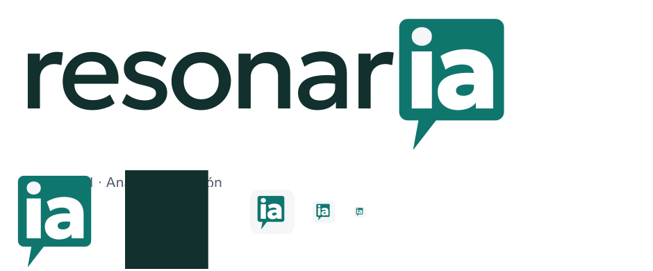

# Identidad visual — Resonaria

**Estado:** sistema visual vigente de Resonaria.cl. Conserva la lupa aprobada de Que Perdimos y adapta el wordmark, las variantes y los iconos al nuevo medio de actualidad, análisis y opinión.

## Idea de marca

La lupa representa observación, investigación y atención al detalle. Conserva el trazo verde petróleo y el segmento violeta separados del diseño aprobado. El nombre **Resonaria** usa una sans humanista pesada de formas redondeadas; sus letras están delineadas en los SVG para conservar su forma en todas las plataformas. La tipografía de interfaz del sitio sigue siendo Schibsted Grotesk.

Las letras finales **ia** de Resonaria se destacan en violeta, integradas en la misma palabra y sin un sello adicional. Este detalle señala que agentes de inteligencia artificial apoyan funciones de trabajo editorial. Es una referencia a las herramientas del medio: no implica que cada contenido se genere automáticamente ni reemplaza fuentes, atribución o revisión humana.

## Recursos vigentes

| Recurso | Uso | Archivo |
| --- | --- | --- |
| Logo horizontal | Encabezado y pie del sitio | [logo.svg](../../apps/web/public/brand/logo.svg) |
| Logo con descriptor | Presentaciones y piezas editoriales | [logo-descriptor.svg](../../apps/web/public/brand/logo-descriptor.svg) |
| Logo blanco y monocromo | Fondos oscuros y aplicaciones de una tinta | [variantes SVG](../../apps/web/public/brand/) |
| Isotipo de lupa | Navegación compacta y firma | [isotipo.svg](../../apps/web/public/brand/isotipo.svg) |
| Icono cuadrado | Favicon, manifiesto e iconos de aplicación | [icono.svg](../../apps/web/public/brand/icono.svg) |
| Vista de identidad aplicada | Revisión visual del conjunto | [identidad-aplicada.png](assets/brand/identidad-aplicada.png) |

Las fuentes editables para generar el sistema están en `scripts/brand/generate-resonaria-assets.py`; las derivaciones PNG y el favicon ICO se producen con `scripts/brand/export-assets.cjs`. La forma de la lupa proviene de la propuesta aprobada guardada en `propuesta-diseno/identidad/`.

## Aplicación y accesibilidad

El logo horizontal se usa en el encabezado y el pie. La lupa sola se usa en la navegación compacta. El icono cuadrado se usa en el favicon y en el manifiesto web. Las imágenes dentro de enlaces con nombre accesible son decorativas para evitar duplicar la lectura. Las versiones blancas se destinan a fondos oscuros. Las versiones blancas y monocromas usan una sola tinta. La lupa y el nombre forman un conjunto compacto: el espacio entre ambos equivale aproximadamente a un cuarto del cuerpo tipográfico.

## Historial

Las láminas de [identidad](../../propuesta-diseno/identidad/) documentan el proceso anterior. Los archivos históricos con el nombre Que Perdimos no deben usarse como recursos activos del sitio.
