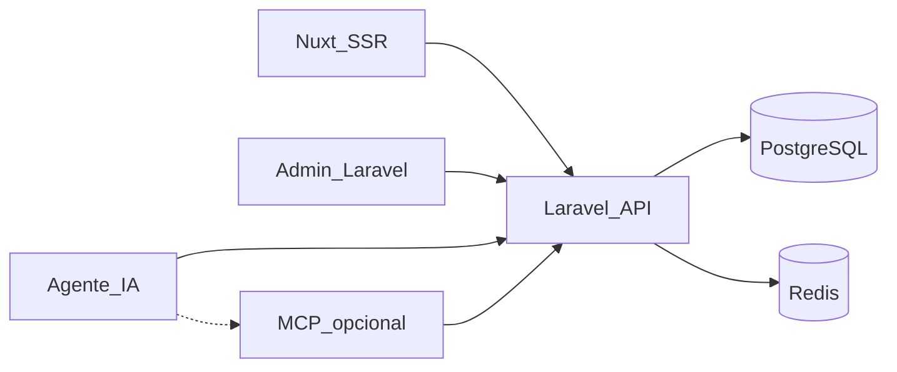

# Overview Laravel + Nuxt

## División de responsabilidades

| Capa | Tecnología | Rol |
| --- | --- | --- |
| Portal público | Nuxt (SSR) | Portada, catálogo, fichas, comparador, SEO, assets estáticos (`robots`, `llms`) |
| API y reglas | Laravel | Modelo de datos, autorización, versionado, búsqueda, jobs |
| Admin | Laravel (Blade/Inertia o API + UI mínima) | Cola de revisión, publicación, auditoría |
| Colas | Redis + Laravel Queue | Ingesta, alertas, tareas pesadas |
| Persistencia | MySQL (local) / PostgreSQL (opcional en prod) | Contenido relacional y trazabilidad |

## Principios

- **Una sola fuente de verdad** en Laravel; Nuxt no calcula comparaciones presupuestarias distintas al backend.
- **Sin escritura pública** en API; tokens con scopes granulares para agentes.
- **SSR** para HTML crawlable y metas OG en primera respuesta.

## Monorepo

```
apps/api/     # Laravel
apps/web/     # Nuxt
deploy/       # docker-compose.yml (futuro)
docs/         # Esta biblia
public/       # Plantillas robots/llms servidas o copiadas al build
```

## Diagrama



## Referencias

- [contratos-api.md](contratos-api.md)
- [flujo-editorial.md](flujo-editorial.md)
- [self-host.md](self-host.md)
- [integracion-mcp.md](integracion-mcp.md)
