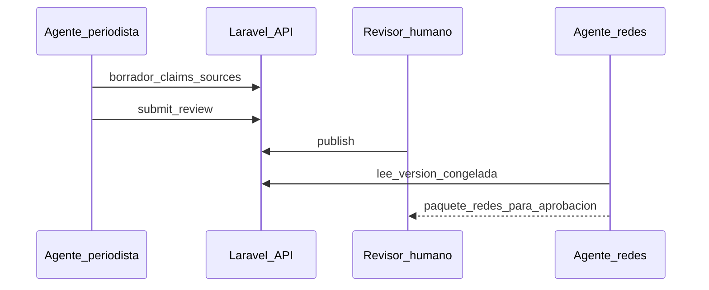

# Orquestación de agentes

Administración y contenido desde **Cursor, Claude, ChatGPT** u otros, sin acoplar a un vendor.

## Flujo recomendado

1. Periodista crea/actualiza expediente (API o MCP).
2. Estado `in_review`.
3. Humano aprueba/publica.
4. Redes genera variantes sobre `content_version` publicada.

## Vías de conexión

| Cliente | Vía |
| --- | --- |
| Cualquiera | REST + OpenAPI + Bearer token |
| Cursor / Claude local | MCP `Mcp::local` |
| Conectores remotos | MCP `Mcp::web` + Sanctum |

## Capacidades por cliente

| Capacidad | REST | MCP |
| --- | --- | --- |
| Borradores | Sí | Sí (tools) |
| Publicar | Solo token revisor | Tool restringida / ausente |
| Metodología | GET / páginas | MCP Resource |

## Datos sensibles

- No enviar aportes de lectores con PII al LLM sin política explícita.
- Logs: tool/endpoint, id de caso, sin volcar documentos completos.

## Catálogo MCP

Ver [../05-arquitectura/integracion-mcp.md](../05-arquitectura/integracion-mcp.md).

## Agentes documentados

- [../agents/periodista-investigador.md](../agents/periodista-investigador.md)
- [../agents/redes-contenido.md](../agents/redes-contenido.md)
- [../agents/dev-portal.md](../agents/dev-portal.md)
